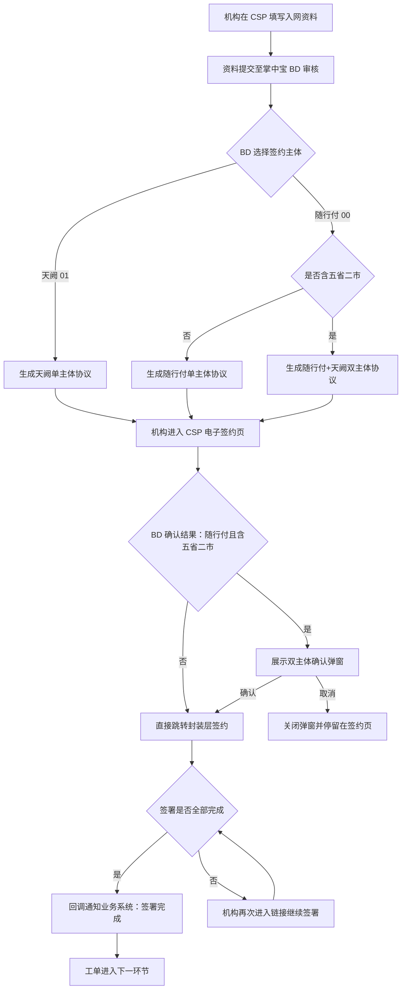
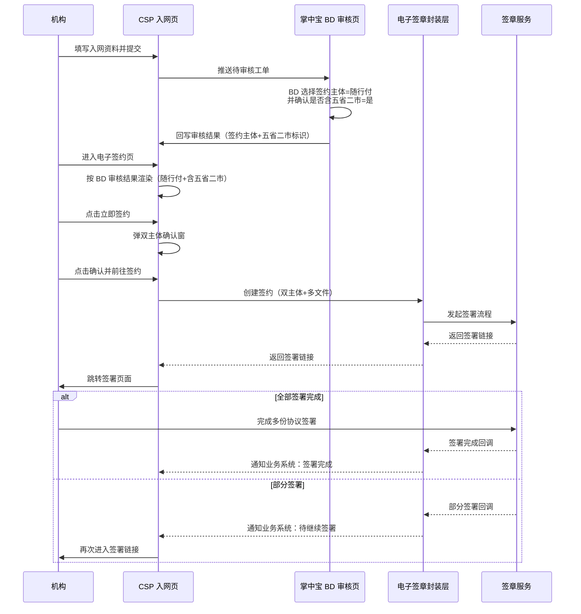

# 机构入网双主体签署需求 PRD

| 版本 | 日期 | 作者 | 变更说明 |
|---|---|---|---|
| V1.5 | 2026-11-11 | 产品 | 基于 PM 工作流评审后定稿：明确推荐方案三（掌中宝 BD 审核节点触发），补充方案对比、异常处理、安全策略、接口示例与原型链接 |

## 1. 背景

在五省二市作业的新入网机构需要同时与随行付、天阙两个我司主体签约。现有电子签章流程一次签署流程只能指定一个我司主体为甲方，业务侧只能拆成多个签约流程分别发起，导致签署体验割裂、状态对账成本高、机构多次操作。

## 2. 目标

一次签署流程内支持多个我司主体（甲方）同时签署，本次聚焦机构入网协议场景。

| 目标 | 验收标准 |
|---|---|
| 单次调用可传入 2 个及以上甲方主体 | 双主体场景下，一次创建签约请求同时包含随行付、天阙两个甲方 |
| 签署体验不割裂 | 机构侧仅见一份待签署任务，按展示顺序连续签署多份协议 |
| 状态对账成本可控 | 业务侧通过同一外部签约 ID 查询整批协议签署状态，无需多流程轮询 |

## 3. 推荐方案

### 3.1 方案总览

三个方案在「何时、在哪确认机构需要同时签署双主体协议」上存在差异：

| 方案 | 五省二市确认时机 | 确认页面 | 签约主体选择 | 电子签约页处理 | 主要问题 |
|---|---|---|---|---|---|
| 方案一 | CSP 机构资料填写节点 | CSP 机构资料页 | BD 审核节点选择 | 按 BD 选择渲染；随行付时展示五省二市确认结果，天阙时不展示 | CSP 已确认五省二市，但 BD 审核节点仍可切换签约主体，前后信息可能不一致 |
| 方案二 | CSP 机构电子签约节点 | CSP 机构电子签约页 | BD 审核节点（或本页） | 在签约页首次必填五省二市；选「是」弹窗，选「否」直接跳转 | 该节点机构信息已落库，此时才判断是否需要签双主体，时机较晚，可能需要回退或重新生成协议 |
| **方案三（推荐）** | 掌中宝 BD 审核节点 | 掌中宝 BD 审核页 | 与五省二市确认合并 | 按 BD 选择结果只读展示；随行付且含五省二市时弹双主体确认窗 | BD 选择存在误操作可能，需增加必填校验与二次确认 |

### 3.2 推荐方案三理由

- **信息最准确**：BD 在审核时明确机构实际签约主体与作业范围，可一次性确认双主体签署需求。
- **改造面最小**：CSP 机构资料填写页与电子签约页无需新增五省二市输入字段，仅在掌中宝 BD 审核页增加「签约主体 + 是否含五省二市」联动选择。
- **闭环最清晰**：BD 确认后，CSP 电子签约页按结果只读展示，机构仅需知情确认，无额外决策成本。

### 3.3 方案三风险与缓解

| 风险 | 影响 | 缓解措施 |
|---|---|---|
| BD 误选签约主体或五省二市 | 生成错误协议，机构签署后需撤销重签 | 1. 选择「随行付」时，「是否含五省二市」必填；2. 提交前弹窗二次确认；3. 审核记录留痕，支持运营后台追溯 |
| 机构后续反馈不在五省二市作业 | 已生成双主体协议，需要关闭工单重发 | 审核节点增加「请与机构确认作业范围」提示；协议生成后未签署前允许 BD 撤销并重新发起；签署后按业务规则处理已签协议 |

## 4. 数据可行性

- 掌中宝 BD 审核页已具备「签约主体」选择能力，本次仅增加「展业范围是否含五省二市」联动字段。
- CSP 电子签约页已支持按签约主体动态渲染，新增条件分支即可。
- 电子签章封装层已支持批量文件、多方签署，本次仅调整传参逻辑。
- 五省二市省市范围（黑龙江、吉林、辽宁、浙江、福建（厦门除外））可配置在运营后台，避免硬编码。

## 5. 方案流程

### 5.1 主流程：掌中宝 BD 审核触发双主体签署



### 5.2 CSP 电子签约页跳转规则

CSP 电子签约页**不再让机构重新选择**「是否含五省二市」，而是按掌中宝 BD 审核结果只读展示，避免前后状态不一致：

| BD 审核选择签约主体 | 五省二市结果 | 电子签约页展示 | 点击「立即签约」行为 |
|---|---|---|---|
| 随行付（00） | 是 | 展示「经 BD 确认，贵机构展业范围含五省二市，需同时签署双主体协议」提示 | 弹双主体确认窗 → 跳转封装层 |
| 随行付（00） | 否 | 不展示双主体提示 | 直接跳转封装层 |
| 天阙（01） | — | 不展示「五省二市」相关内容 | 直接跳转封装层 |

## 6. 时序图



## 7. 页面说明

### 7.1 掌中宝 BD 审核页

| 元素 | 说明 |
|---|---|
| 字段名称 | 签约主体 |
| 控件类型 | 单选，选项：随行付（00）、天阙（01） |
| 联动字段 | 选择「随行付」时，展示「展业范围是否含五省二市」单选；选择「天阙」时隐藏 |
| 必填校验 | 签约主体必填；选择随行付时，五省二市必填 |
| 二次确认 | BD 提交审核前弹窗确认所选主体与五省二市结果 |

### 7.2 CSP 机构电子签约页

| 元素 | 说明 |
|---|---|
| 字段名称 | 五省二市确认结果（只读展示） |
| 控件类型 | 文本提示，非输入框 |
| 展示条件 | 仅当 BD 审核选择签约主体=随行付且五省二市=「是」时展示 |
| 提示文案 | 「经 BD 确认，贵机构展业范围含五省二市，需同时签署随行付、天阙双主体协议。」 |
| 点击「立即签约」交互 | 展示「合作协议签署提醒」弹窗，机构点击「确认并前往签约」后跳转封装层 |
| 取消弹窗 | 弹窗收起，停留在电子签约页 |

### 7.3 合作协议签署提醒弹窗文案

> 尊敬的合作伙伴：若您将在五省二市【黑龙江、吉林、辽宁、浙江、福建（厦门除外）地区】作业，为完善上述地区商户支付能力，明确双方权责、保障贵机构合法权益，您在与随行付支付有限公司签约的同时，需同步与北京天阙科技有限公司签署合作协议。请点击签约链接完成协议签署。期待与您开展新的合作篇章，大展宏图，感谢您一直以来的理解与支持！

按钮：取消 / 确认并前往签约

## 8. 字段规则

### 8.1 掌中宝 BD 审核页新增/调整字段

| 字段名 | 必填 | 类型 | 默认值 | 规则 |
|---|---|---|---|---|
| 签约主体 | 是 | String | 空 | 枚举：00 随行付、01 天阙 |
| 展业范围是否含五省二市 | 条件必填 | String | 空 | 签约主体=00 时必填；枚举：是、否 |

### 8.2 CSP 电子签约页字段

| 字段名 | 必填 | 类型 | 默认值 | 规则 |
|---|---|---|---|---|
| 五省二市确认结果 | 否 | String | 空 | 仅展示，取值：是、否；签约主体=00 时展示 |

## 9. 接口定义

### 9.1 创建签约并获取链接

本次唯一需要改造的接口。以下参数沿用现有接口字段命名，仅说明双主体场景下的传参规则。

| 参数名 | 必填 | 类型 | 说明 | 双主体场景传参 |
|---|---|---|---|---|
| 外部签约 ID | 是 | String | 业务方唯一 ID，一个工单可对应多个签约请求 ID | 单次请求唯一 |
| 回调地址 | 否 | String | 接收签约状态通知 | 业务侧提供 |
| 签署流程配置 | 是 | Object | 签约流程基础配置 | 必填 |
| └ 签约主题 | 是 | String | 签约主题 | 机构入驻签约 |
| └ 签署流程是否自动完结 | 否 | String | 00 是，01 否，默认 00 | 默认 00 |
| └ 重定向地址 | 是 | String | 签署完成后跳转页面 | CSP 登录页 |
| 签约文件 | 是 | Array | 支持批量签约 | 按主体连续传入 |
| └ L 待签文件 | 是 | String | 待签文件 Base64 编码 | 已填充完整协议字段值的待签约协议文件 |
| └ L 协议名称 | 是 | String | 待签协议名称 | 合作服务协议、补充协议/【归档模式】补充协议 |
| └ L 协议外部 ID | 否 | String | 业务系统侧文件唯一标识 | 建议传入，便于落章位置匹配 |
| └ L 展示顺序 | 否 | Int | 展示顺序，1-50，值越小越靠前 | 随行付合作服务协议：1；随行付补充协议：2；天阙合作服务协议：3；天阙补充协议：4 |
| 签署方信息 | 是 | Array | 签署方列表 | 双主体传 3 组，单主体传 2 组 |
| └ L 签署方类型 | 是 | String | 00 商户，01 机构，02 我司 | 机构传 01，我司传 02 |
| └ L 商户编号 | 否 | String | 商户类签约必填 | 机构场景不传 |
| └ L 机构编号 | 否 | String | 机构类签约必填 | 签署方为机构时传机构 ID |
| └ L 我司主体 | 条件必填 | String | 00 随行付，01 天阙，02 重庆鑫联 | 签署方为我司时必填 |
| └ L 签署区信息 | 是 | Array | 各协议落章位置 | 按协议外部 ID 匹配 |
| &nbsp;&nbsp;&nbsp;&nbsp;LL 协议外部 ID | 否 | String | 用于判断落章位置，单协议签署可不传 | 多协议场景建议传入 |
| &nbsp;&nbsp;&nbsp;&nbsp;LL 签章页码 | 是 | String | 协议用印页面 | 协议文件最后一页 |
| &nbsp;&nbsp;&nbsp;&nbsp;LL 签章坐标 X | 是 | String | 协议维度坐标 | 按协议模板确定 |
| &nbsp;&nbsp;&nbsp;&nbsp;LL 签章坐标 Y | 是 | String | 协议维度坐标 | 按协议模板确定 |

### 9.2 传参规则

1. **主体按签署方分别传入**：在「签署方信息[].L 我司主体」中列出本次参与签署的所有我司主体。
2. **文件按主体连续传入**：同一主体的文件在「签约文件」数组中连续排列，先传随行付协议，再传天阙协议。签章服务按文件传入顺序排序展示。
3. **签署区按协议匹配**：通过「L 协议外部 ID」与「LL 协议外部 ID」关联，确保每份协议的落章位置正确。

### 9.3 请求示例（双主体 + 4 份文件 + 3 个签署方）

```json
{
  "外部签约 ID": "REQ-20261111-0001",
  "回调地址": "https://your-domain.com/sign-callback",
  "签署流程配置": {
    "签约主题": "机构入驻签约",
    "签署流程是否自动完结": "00",
    "重定向地址": "https://csp.your-domain.com/login"
  },
  "签约文件": [
    { "L 协议外部 ID": "A1001", "L 协议名称": "合作服务协议", "L 待签文件": "<Base64>", "L 展示顺序": 1 },
    { "L 协议外部 ID": "A1002", "L 协议名称": "补充协议", "L 待签文件": "<Base64>", "L 展示顺序": 2 },
    { "L 协议外部 ID": "B1001", "L 协议名称": "合作服务协议", "L 待签文件": "<Base64>", "L 展示顺序": 3 },
    { "L 协议外部 ID": "B1002", "L 协议名称": "补充协议", "L 待签文件": "<Base64>", "L 展示顺序": 4 }
  ],
  "签署方信息": [
    { "L 签署方类型": "02", "L 我司主体": "00", "L 签署区信息": [
      { "LL 协议外部 ID": "A1001", "LL 签章页码": "0", "LL 签章坐标 X": "300", "LL 签章坐标 Y": "200" },
      { "LL 协议外部 ID": "A1002", "LL 签章页码": "0", "LL 签章坐标 X": "300", "LL 签章坐标 Y": "200" }
    ]},
    { "L 签署方类型": "02", "L 我司主体": "01", "L 签署区信息": [
      { "LL 协议外部 ID": "B1001", "LL 签章页码": "0", "LL 签章坐标 X": "300", "LL 签章坐标 Y": "200" },
      { "LL 协议外部 ID": "B1002", "LL 签章页码": "0", "LL 签章坐标 X": "300", "LL 签章坐标 Y": "200" }
    ]},
    { "L 签署方类型": "01", "L 机构编号": "ORG-20261111-0001", "L 签署区信息": [
      { "LL 协议外部 ID": "A1001", "LL 签章页码": "0", "LL 签章坐标 X": "100", "LL 签章坐标 Y": "100" },
      { "LL 协议外部 ID": "A1002", "LL 签章页码": "0", "LL 签章坐标 X": "100", "LL 签章坐标 Y": "100" },
      { "LL 协议外部 ID": "B1001", "LL 签章页码": "0", "LL 签章坐标 X": "100", "LL 签章坐标 Y": "100" },
      { "LL 协议外部 ID": "B1002", "LL 签章页码": "0", "LL 签章坐标 X": "100", "LL 签章坐标 Y": "100" }
    ]}
  ]
}
```

### 9.4 新增校验规则

| 校验项 | 规则 | 拦截提示 |
|---|---|---|
| 我司主体必传且合法 | 签署方类型=02 时必填，取值 ∈ {00,01,02} | 「签署方为我司时，必须指定我司主体」 |
| 我司主体数量上限 | 去重后主体数 ≤ 8 | 「一次签约流程最多支持 8 个我司主体」 |
| 文件主体归属 | 同一主体文件必须连续传入 | 「同一主体的文件需连续传入」 |
| 协议外部 ID 唯一 | 签约文件中「L 协议外部 ID」不可重复 | 「协议外部 ID 重复」 |
| 落章位置匹配 | 签署区中的「LL 协议外部 ID」需在签约文件中存在 | 「落章位置对应的协议不存在」 |

### 9.5 返回示例

```json
{
  "code": "000000",
  "message": "成功",
  "data": {
    "外部签约 ID": "REQ-20261111-0001",
    "签署链接": "https://sign.example.com/s/xxx",
    "签署流程 ID": "FLOW-20261111-0001"
  }
}
```

### 9.6 常见错误码

| 错误码 | 说明 | 前端提示 |
|---|---|---|
| 000000 | 成功 | — |
| 100001 | 参数校验失败 | 请检查填写内容后重试 |
| 100002 | 我司主体重复 | 同一主体不能重复传入 |
| 100003 | 文件与主体归属不一致 | 同一主体文件需连续传入 |
| 100004 | 落章位置不匹配 | 请检查签章坐标与协议对应关系 |
| 999999 | 系统繁忙 | 系统繁忙，请稍后重试 |

## 10. 异常处理

| 异常场景 | 触发条件 | 处理方式 | 前端提示 |
|---|---|---|---|
| CSP 页未读到 BD 审核结果 | 电子签约页未拿到五省二市确认标识 | 阻断提交，提示机构联系 BD 完成审核 | 审核结果未同步，请联系 BD 完成审核 |
| 取消双主体确认弹窗 | 机构点击弹窗「取消」 | 关闭弹窗，停留在电子签约页 | — |
| BD 未选五省二市 | BD 选随行付但未选五省二市就提交审核 | 阻断提交 | 选择随行付时，必须确认机构是否含五省二市作业 |
| 协议生成后未签署前 BD 发现选错 | BD 在掌中宝审核结果页点击「撤销并重新发起」 | 关闭当前签署流程，回退至 BD 审核节点重新选择 | 当前协议未签署，已撤销，请重新确认签约主体 |
| 创建签约失败 | 封装层返回错误 | 停留在电子签约页，允许重新发起 | 签约发起失败，请稍后重试 |
| 签署链接失效 | 链接超过有效期 | 返回电子签约页重新获取 | 链接已失效，请重新发起签约 |
| 机构部分签署 | 双主体场景下只完成部分协议签署 | 业务侧通过签署流程 ID 查询每份文件签署状态；签章服务保留未签署文件，允许机构再次进入链接完成剩余签署 | 您还有未完成的协议，请继续签署 |
| 机构拒签 | 机构在签章服务侧拒绝签署任意一份协议 | 接收回调，更新整批流程状态为「签署拒绝」；已签署的协议按业务规则决定是否作废或保留 | — |

## 11. 安全策略

- **HTTPS 传输**：所有页面与接口强制使用 HTTPS。
- **幂等控制**：外部签约 ID 作为幂等键，同一 ID 重复请求返回相同结果，避免重复创建流程。
- **敏感信息脱敏**：身份证号、手机号、银行卡号等敏感字段在日志中脱敏展示。
- **回调验签**：签章服务回调需验签，防止伪造通知。
- **链接有效期**：签署链接设置有效期（建议 7 天），过期后需重新发起。
- **权限控制**：BD 审核节点操作需校验 BD 归属机构权限；CSP 电子签约页仅允许当前机构经办人访问。
- **接口频次限制**：创建签约接口按调用方限流（建议 60 秒内不超过 30 次），防止恶意刷单。
- **审计日志**：掌中宝 BD 审核结果、CSP 电子签约页签署发起、签章服务回调状态均需记录审计日志，保留 1 年。

## 12. 数据埋点

| 事件名 | 触发时机 | 采集字段 |
|---|---|---|
| bd_audit_subject_select | BD 选择签约主体 | 工单号、主体编码、是否含五省二市 |
| csp_sign_scope_show | 电子签约页展示五省二市确认结果 | 工单号、展示值 |
| csp_double_subject_confirm_show | 双主体确认弹窗展示 | 工单号 |
| csp_double_subject_confirm_click | 点击确认/取消 | 工单号、按钮 |
| sign_create_request | 发起创建签约 | 工单号、主体数量、文件数量 |
| sign_create_success | 创建签约成功 | 工单号、签署流程 ID |
| sign_create_fail | 创建签约失败 | 工单号、错误码 |

## 13. 协议归档

本次需求**不考虑新增归档能力**。双主体签署完成后，各协议文件的 PDF 由签章服务提供下载链接，业务侧沿用现有下载接口按需获取。

## 14. 原型访问

- 导航首页：https://gaohailinga.github.io/esign-multi-party-prototypes/
- 流程图与时序图：https://gaohailinga.github.io/esign-multi-party-prototypes/flowchart.html
- 掌中宝 BD 审核页（推荐方案）：https://gaohailinga.github.io/esign-multi-party-prototypes/zzb-bd-audit.html
- 掌中宝 BD 审核页（评审标注版）：https://gaohailinga.github.io/esign-multi-party-prototypes/zzb-bd-audit-review.html
- CSP 电子签约页（含五省二市）：https://gaohailinga.github.io/esign-multi-party-prototypes/csp-sign-protocol-with-scope-prototype.html
- CSP 电子签约页（不含五省二市）：https://gaohailinga.github.io/esign-multi-party-prototypes/csp-sign-protocol-prototype.html
- 机构入网信息填写页：https://gaohailinga.github.io/esign-multi-party-prototypes/org-entry-info-prototype.html

---

## 15. 需求-方案追溯矩阵

| 原始需求点 | 本 PRD 落地位置 | 偏离说明 |
|---|---|---|
| 一次签署流程支持多个我司主体 | 第 2 章目标、第 9 章接口 | 无偏离 |
| 方案三：掌中宝 BD 审核节点触发 | 第 3 章推荐方案 | 明确为推荐方案，并补充风险缓解 |
| 电子签约页公共跳转规则 | 第 5.2 节、第 7.2 节 | 无偏离 |
| 五省二市弹窗文案 | 第 7.3 节 | 文案沿用原始需求 |
| 签约文件展示顺序 | 第 9.1 节 | 明确按主体连续、按展示顺序排序 |
| 此需求不考虑归档 | 第 13 章 | 无偏离 |
