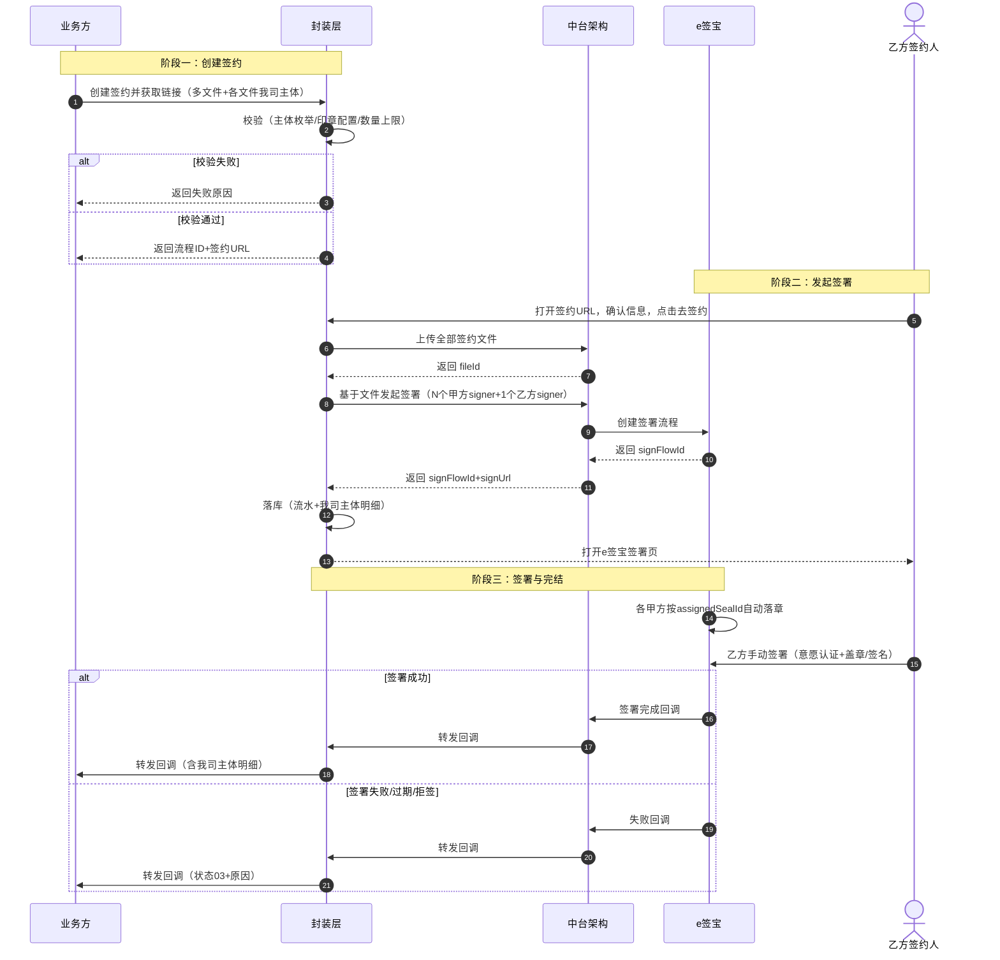

# 电子签章改造（e签宝）—— 多我司主体（多甲方）签署能力 PRD

| 版本 | 日期 | 作者 | 变更说明 |
|---|---|---|---|
| V1.0 | 2026-11-09 | 产品 | 首次输出 |
| V1.1 | 2026-11-09 | 产品 | 取消全局兜底：「签约文件[].我司主体」改为逐文件必传，「签署方信息.我司主体」字段删除；存量单甲方调用需同步加传该字段 |

---

## 1. 背景

**术语约定**：本 PRD 中「甲方」即「我司主体」（00 随行付 / 01 天阙 / 02 重庆鑫联），两者指同一概念；接口字段统一命名为「我司主体」，新增字段为 `签约文件[].我司主体`。

### 1.1 现状

电子签章改造（e签宝通道）已上线，封装层通过「创建签约并获取链接」对外提供批量签署能力：

- 一次签署流程支持最多 10 份签约文件批量签署；
- 签署方固定为「1 个我司主体（甲方）+ 1 个商户/机构（乙方）」；
- 甲方（我司主体：00 随行付 / 01 天阙 / 02 重庆鑫联）通过 e签宝自动落章（autoSign=true + 主体印章 ID），一次流程只能指定一个我司主体；
- 乙方按签约页面采集的签约人信息手动签署。

调用中台架构时，appid「优先使用签署人=我司的 appid，如果有多个先任取 1 个」，所有文件的签章区都挂载在同一个甲方签署方下。

### 1.2 问题

部分批量签署场景中，同一批协议的我司主体并不相同。例如：

| 协议 | 我司主体 |
|---|---|
| 合作服务协议（A 组） | 随行付 |
| 补充协议（A 组） | 随行付 |
| 合作服务协议（B 组） | 天阙 |
| 补充协议（B 组） | 天阙 |

现状能力无法在一次签署流程中表达「多份文件 + 多个甲方签署方」，业务线只能拆成多个签约流程分别发起，导致：

- 乙方需要多次签约操作，签署体验割裂；
- 多个签约流程之间无关联，状态查询、回调、对账成本高；
- 协议组与签约流水无法一一对应。

### 1.3 改造范围

| 系统 | 是否改造 | 说明 |
|---|---|---|
| 封装层「创建签约并获取链接」 | 是 | 核心改造：按我司主体聚合签章区，生成多个甲方签署方 |
| 封装层「查询签约状态 / 签约结果回调」 | 是（小） | 签署方信息中增加我司主体标识 |
| 签约流水表 | 是 | 我司主体由单值扩展为多值明细 |
| 中台架构接口 | 否 | `/esign-signature/sign` 已支持多签署方（signers 数组）、多文件（docs 数组），无需改动 |
| e签宝开放平台 | 否 | 直接使用现有能力，无新接口、无新套餐 |
| 业务线调用方 | 是（小） | 批量签署时按协议传入我司主体 |

---

## 2. 目标

1. 一次签署流程内支持多份文件分别由不同我司主体（甲方）自动落章；
2. 对外接口向后兼容：存量单甲方调用需新增「签约文件[].我司主体」字段（仅加一个字段，其余传参不变）；
3. 签署状态、回调、流水可按我司主体追溯（哪个主体盖了哪些协议）；
4. 不改变乙方（商户/机构）签署体验，签署页面流程保持不变。

---

## 3. e签宝接口对接参数分析

### 3.1 接口结论

e签宝「基于文件发起签署」（`POST /v3/sign-flow/create-by-file`）原生支持本需求，无需新增接口：

| 能力 | 接口参数 | 对本需求的意义 |
|---|---|---|
| 多文件 | `docs[]`，最多 50 个文件、总大小 ≤500MB | 已用于批签 |
| 多签署方 | `signers[]`，一次最多传 10 个 | 天然支持多个甲方签署方并存 |
| 一方盖多份文件 | `signers[].signFields[]` 数组，每个签署区的 `fileId` 可指向 `docs[]` 中任意文件 | 同一甲方的多份协议聚合到一个签署方 |
| 一份文件多方签 | 多个签署方的 `signFields` 可指向同一 `fileId` | 同一协议多主体盖章不冲突 |
| 平台方自动落章 | `signerType=1` + `normalSignFieldConfig.autoSign=true` + `assignedSealId=主体印章ID` | 每个甲方仅印章 ID 不同 |
| 多枚印章共存 | 同一 appId 企业空间下可配置多枚印章，用 `assignedSealId` 区分 | 无需切换 appId、无需多流程 |

### 3.2 多甲方传参结构（示例）

2 个甲方（随行付、天阙）+ 1 个乙方（企业商户）：

```json
{
  "docs": [
    { "fileId": "F1", "fileName": "合作服务协议-随行付.pdf", "order": 1 },
    { "fileId": "F2", "fileName": "补充协议-随行付.pdf", "order": 2 },
    { "fileId": "F3", "fileName": "合作服务协议-天阙.pdf", "order": 3 },
    { "fileId": "F4", "fileName": "补充协议-天阙.pdf", "order": 4 }
  ],
  "signers": [
    {
      "signerType": 1,
      "signFields": [
        { "fileId": "F1", "normalSignFieldConfig": { "autoSign": true, "assignedSealId": "{随行付印章ID}", "signFieldStyle": 1, "signFieldPosition": { "positionPage": "1", "positionX": 300, "positionY": 200 } } },
        { "fileId": "F2", "normalSignFieldConfig": { "autoSign": true, "assignedSealId": "{随行付印章ID}", "signFieldStyle": 1, "signFieldPosition": { "positionPage": "1", "positionX": 300, "positionY": 200 } } }
      ]
    },
    {
      "signerType": 1,
      "signFields": [
        { "fileId": "F3", "normalSignFieldConfig": { "autoSign": true, "assignedSealId": "{天阙印章ID}", "signFieldStyle": 1, "signFieldPosition": { "positionPage": "1", "positionX": 300, "positionY": 200 } } },
        { "fileId": "F4", "normalSignFieldConfig": { "autoSign": true, "assignedSealId": "{天阙印章ID}", "signFieldStyle": 1, "signFieldPosition": { "positionPage": "1", "positionX": 300, "positionY": 200 } } }
      ]
    },
    {
      "signerType": 1,
      "orgSignerInfo": {
        "orgName": "{商户注册名}",
        "orgInfo": { "orgIDCardType": "CRED_ORG_USCC", "orgIDCardNum": "{营业执照号}" },
        "transactorInfo": { "psnAccount": "{经办人手机号}", "psnInfo": { "psnName": "{经办人姓名}" } }
      },
      "signFields": [
        { "fileId": "F1", "normalSignFieldConfig": { "autoSign": false, "orgSealBizTypes": "PUBLIC", "signFieldPosition": { "positionPage": "1", "positionX": 100, "positionY": 200 } } }
      ]
    }
  ]
}
```

### 3.3 关键约束（e签宝侧）

| # | 约束 | 封装层对策 |
|---|---|---|
| 1 | 签署方一次最多 10 个（超出需「追加签署区」，流程上限 50） | 甲方数量与乙方合计 ≤ 10，封装层限制甲方 ≤ 8 |
| 2 | 签署区（signFields）全流程 ≤ 300 | 保持现有 ≤ 30 组限制 |
| 3 | 自动落章签署方（平台自身主体）建议不传 `orgSignerInfo`，以 `assignedSealId` 指定印章 | 甲方 signer 不传 orgSignerInfo（与 e签宝附录「appId 对应的自身机构自动落章」场景一致） |
| 4 | 所有甲方印章必须已在该 appId 对应企业空间配置；印章 ID 无效发起报错 | 发起前校验每个我司主体的印章 ID 配置存在 |
| 5 | `autoSign=true` 由 e签宝在流程开启后自动落章，无需访问签署页 | 甲方不涉及签署页面改造 |
| 6 | 文件名称不可含 9 种特殊字符（/ \ : * " < > | ？）及 emoji，≤100 字符 | 沿用现有签约文件名校验 |

---

## 4. 推荐方案

**方案 A：签约文件维度指定我司主体（推荐）**

业务方在「签约文件」组中为每份协议传入「我司主体」；封装层按我司主体将签章区聚合为多个甲方签署方，一次调用生成完整签署流程。

理由：
- 语义清晰：一份协议的甲方通常唯一，以文件为单位最贴合业务；
- 改动最小：仅在「签约文件」结构上新增 1 个字段，内部聚合规则集中封装层；
- 主体来源唯一：所有主体由「签约文件[].我司主体」逐文件指定，无全局兜底（存量单甲方调用需同步加传该字段）；
- 可扩展：若未来同一份协议需多甲方落章，再增加签署区维度的「我司主体」字段，优先级高于文件维度，架构预留不预建。

**方案 B（备选）：签署区维度指定我司主体**

在「签署区信息」组中为每个签章区指定我司主体，同一份协议可由多个甲方在不同位置落章。灵活度更高，但业务方传参复杂度上升，当前业务无此诉求，暂不实施，仅在字段设计中预留优先级规则（签署区维度 > 文件维度）。

---

## 5. 流程

### 5.1 整体签署流程（改造后）

```
业务方生成批量协议文件（含每份协议的我司主体）
  ↓ 调用封装层「创建签约并获取链接」
封装层校验（文件数、我司主体枚举、印章配置、签署区上限）
  ↓ 校验通过
生成封装层流程ID + 签约URL（签署信息确认页），落签约流水（含我司主体明细）
  ↓ 乙方在确认页点击「去签约」
封装层上传全部文件 → 组装 signers（N 个甲方 signer + 1 个乙方 signer）→ 调中台「基于文件发起签署」
  ↓ 返回 signFlowId，落库
e签宝自动为各甲方落章（autoSign=true，按 assignedSealId 区分主体）
  ↓ 自动落章完成
乙方在 e签宝页面完成手动签署
  ↓ 全部签署完成
流程完结（autoFinish=true）→ 回调中台 → 封装层 → 转发业务线
```

### 5.2 封装层内部映射规则

1. 逐份文件解析「我司主体」，**逐文件必传**；
2. **文件排序（决定签署页展示顺序，业务层职责）**：签约文件与各文件的「我司主体」均由业务层传入，**展示顺序由业务层按固定主体顺序传参保证**——先传 `00 随行付` 的协议，再传 `01 天阙` 的协议，`02 重庆鑫联` 最后；封装层不做重排，按传入顺序透传生成 e签宝 `docs[].order`（order = 1..N）；
3. 按我司主体分组：每个甲方生成 1 个 `signerType=1 + autoSign=true` 的签署方，`assignedSealId` 取该主体配置的印章 ID，不传 `orgSignerInfo`；甲方签署方在 `signers` 数组中按其在文件列表中的首次出现顺序生成（与业务层传入顺序一致）；
4. 该甲方名下所有签章区（页码、坐标）挂载到其 `signFields` 数组；
5. 乙方签署方按存量逻辑生成（个人/企业签署、经办人信息、认证配置不变），排在甲方签署方之后；
6. 最终 `signers = 甲方签署方列表（按业务层传入顺序） + 乙方签署方列表`，appid 选取逻辑不变。

> **职责划分**：业务层负责「文件内容 + 每份文件的我司主体 + 文件传入顺序（即签署页展示顺序）」；封装层只做校验、聚合与透传，不调整文件顺序。

### 5.3 时序图



---

## 6. 接口定义（封装层改造）

### 6.1 创建签约并获取链接（核心改造）

`POST {封装层}/sign-flow/create`（路径不变）

**请求参数（新增/变更部分，其余不变）**

| 参数名 | 必填 | 类型 | 变更 | 说明 |
|---|---|---|---|---|
| 签约文件[].我司主体 | 是 | String | 新增 | 00 随行付 / 01 天阙 / 02 重庆鑫联。**逐文件必传**（单主体场景每份文件也必须指定） |
| 签署方信息.我司主体 | — | — | 删除 | 不再作为入参；主体一律由「签约文件[].我司主体」逐文件指定，无全局兜底 |

**处理规则**

1. **主体来源唯一**：甲方主体一律由 `签约文件[].我司主体` 逐文件指定，无全局默认值；
2. 按我司主体聚合生成多个甲方签署方（规则见 5.2）；
3. 甲方签署方 `assignedSealId` 按主体映射：随行付 / 天阙 / 重庆鑫联 → 各自印章 ID（沿用现有印章配置表）；
4. **签署页文件展示顺序由业务层传参顺序保证**：业务层按固定主体顺序（先传 `00 随行付`，再传 `01 天阙`，最后传 `02 重庆鑫联`）传入签约文件；封装层按传入顺序透传生成 e签宝 `docs[].order`（1..N），不做重排。

**校验规则（新增部分）**

| 校验项 | 规则 | 拦截提示 |
|---|---|---|
| 我司主体必传且合法 | 逐文件校验已传且取值 ∈ {00,01,02} | 「签约文件[{序号}]未指定我司主体」 / 「我司主体取值不合法，仅支持00随行付/01天阙/02重庆鑫联」 |
| 甲方数量上限 | 去重后我司主体数 ≤ 8 | 「一次签约流程最多支持8个我司主体」 |
| 印章配置 | 每个我司主体的印章 ID 必须已配置 | 「主体[{主体名}]的电子印章未配置，请联系运营」 |
| 签署方总数 | 甲方数 + 乙方数 ≤ 10（e签宝上限） | 「签署方数量超出上限」 |
| 签署区总数 | 全流程 ≤ 30 组（沿用） | 「最多传入30组签署区信息」 |

**返回参数（不变）**

| 参数名 | 类型 | 说明 |
|---|---|---|
| 签署流程ID | String | 封装层流程 ID |
| 签署链接 | String | 签署信息确认页 URL |

### 6.2 查询签约状态（小改造）

**返回参数（新增部分）**

| 参数名 | 类型 | 说明 |
|---|---|---|
| 签署方信息[].我司主体 | String | 签署方为我司时返回，多个甲方返回多组；取值 00/01/02 |

### 6.3 签约结果回调（小改造）

**回调参数（新增部分）**

| 参数名 | 类型 | 说明 |
|---|---|---|
| 签署方信息[].我司主体 | String | 同 6.2；业务线可用于按主体归档 |

### 6.4 其余接口

文件上传、文件状态查询、撤销流程、签约文件下载：无改造。

---

## 7. 数据模型（签约流水）

**新增表：签约流程-我司主体明细表（esign_flow_party_a）**

| 字段 | 类型 | 必填 | 说明 |
|---|---|---|---|
| id | bigint | 是 | 主键 |
| flow_id | varchar(32) | 是 | 封装层签署流程 ID，索引 |
| party_a_code | varchar(2) | 是 | 我司主体编码：00 随行付 / 01 天阙 / 02 重庆鑫联 |
| seal_id | varchar(64) | 是 | 该主体本次使用的 e签宝印章 ID |
| file_ids | varchar(2048) | 是 | 该甲方盖章的协议外部 ID 列表（JSON 数组），用于追溯 |
| create_time | datetime | 是 | 创建时间 |

**存量表改造**

| 表 | 字段 | 改造 |
|---|---|---|
| 签约流水表 | 我司签约主体 | 保留兼容：多甲方时存第一个主体；明细以明细表为准，查询侧关联明细表展示 |

---

## 8. 业务线改造

### 8.1 业务层传参规范（重点）

#### 8.1.1 传参原则

- **我司主体以「签约文件」维度为准**：业务方在每一份协议的元数据中，明确该协议的我司主体；
- **无全局默认值**：「签署方信息.我司主体」不再作为入参，主体必须逐文件指定（存量单甲方调用也需同步新增该字段）；
- **一份协议的甲方必须唯一**：同一协议外部 ID 下的所有签章区必须归属同一个我司主体（除非后续明确开启「同协议多甲方落章」能力）。

#### 8.1.2 字段定义

| 字段 | 位置 | 必填 | 类型 | 取值 | 说明 |
|---|---|---|---|---|---|
| `我司主体` | `签约文件[].我司主体` | 是 | String | `00` 随行付 / `01` 天阙 / `02` 重庆鑫联 | 指定该份协议的我司主体（**逐文件必传**） |
| `我司主体` | `签署方信息.我司主体` | 删除 | — | — | 不再作为入参，主体一律由 `签约文件[].我司主体` 指定 |
| `我司主体` | `签署区信息[].我司主体` | 否 | String | `00` / `01` / `02` | 预留字段，当前阶段不实现；未来同协议多位置落章时使用 |

#### 8.1.3 取值优先级

```
签署区信息.我司主体  >  签约文件.我司主体（当前必传）
```

> 当前阶段「签署方信息.我司主体」已删除；「签约文件[].我司主体」逐文件必传。若文件级未传，则拦截报错。

#### 8.1.4 请求示例

一次批量签署 4 份协议、2 个甲方（随行付、天阙）、1 个乙方：

```json
{
  "签约文件": [
    {
      "协议外部ID": "A1001",
      "协议模板": "合作服务协议",
      "文件路径": "/files/A1001_sxf.pdf",
      "我司主体": "00"
    },
    {
      "协议外部ID": "A1002",
      "协议模板": "补充协议",
      "文件路径": "/files/A1002_sxf.pdf",
      "我司主体": "00"
    },
    {
      "协议外部ID": "B1001",
      "协议模板": "合作服务协议",
      "文件路径": "/files/B1001_tq.pdf",
      "我司主体": "01"
    },
    {
      "协议外部ID": "B1002",
      "协议模板": "补充协议",
      "文件路径": "/files/B1002_tq.pdf",
      "我司主体": "01"
    }
  ],
  "签署方信息": {
    "签署方类型": "01",
    "签约人类型": "01",
    "企业名称": "xxx商户",
    "统一社会信用代码": "9135xxxx",
    "经办人姓名": "张三",
    "经办人手机号": "13800138000"
  },
  "签署区信息": [
    { "协议外部ID": "A1001", "页码": "1", "坐标X": "300", "坐标Y": "200" },
    { "协议外部ID": "A1002", "页码": "1", "坐标X": "300", "坐标Y": "200" },
    { "协议外部ID": "B1001", "页码": "1", "坐标X": "300", "坐标Y": "200" },
    { "协议外部ID": "B1002", "页码": "1", "坐标X": "300", "坐标Y": "200" }
  ]
}
```

> **传参顺序即展示顺序**：上述示例业务层按随行付→天阙顺序传入，签署页按该顺序展示。**业务层需按固定主体顺序（先 `00` 后 `01` 再 `02`）传参**；若业务层乱序传入，签署页将按业务层传入顺序展示，封装层不做重排。

#### 8.1.5 常见错误传参示例

| 错误示例 | 问题 | 正确做法 |
|---|---|---|
| 漏传某份文件的 `我司主体`（误以为还有全局兜底） | 校验不通过，创建失败 | 每份文件都必须指定 `我司主体`，无全局默认值 |
| 同一 `协议外部ID` 下，不同签章区传了不同 `我司主体` | 当前阶段会触发校验失败 | 如需同协议多甲方，走预留的「签署区维度我司主体」方案；否则同一协议只传一个甲方 |
| 把我司主体编码写成中文「随行付」 | 字段类型错误，校验不通过 | 使用编码 `00` / `01` / `02` |
| 把我司主体编码写成中文「随行付」 | 字段类型错误，校验不通过 | 使用编码 `00` / `01` / `02` |

#### 8.1.6 封装层映射结果

上述请求示例传入后，封装层会生成如下 e签宝结构：

```json
{
  "signers": [
    {
      "signerType": 1,
      "signFields": [
        { "fileId": "A1001", "normalSignFieldConfig": { "autoSign": true, "assignedSealId": "{随行付印章ID}" } },
        { "fileId": "A1002", "normalSignFieldConfig": { "autoSign": true, "assignedSealId": "{随行付印章ID}" } }
      ]
    },
    {
      "signerType": 1,
      "signFields": [
        { "fileId": "B1001", "normalSignFieldConfig": { "autoSign": true, "assignedSealId": "{天阙印章ID}" } },
        { "fileId": "B1002", "normalSignFieldConfig": { "autoSign": true, "assignedSealId": "{天阙印章ID}" } }
      ]
    },
    {
      "signerType": 1,
      "orgSignerInfo": { ... },
      "signFields": [ ... ]
    }
  ]
}
```

### 8.2 其他改造点

| 项 | 说明 |
|---|---|
| 协议生成 | 批量生成协议时按模板归属确定每份协议的我司主体，随协议元数据落库 |
| 签约记录展示 | 签约详情/记录页展示多个我司主体（如「甲方：随行付、天阙」） |
| 回调消费 | 回调中按「我司主体」识别协议归属主体（存量逻辑按唯一主体处理的需适配） |

---

## 9. 异常处理

| 场景 | 提示/处理 | 恢复方式 |
|---|---|---|
| 我司主体取值非法（非 00/01/02） | 拦截并返回「我司主体取值不合法」 | 业务方修正后重调 |
| 我司主体数量超上限（>8） | 拦截并返回「最多支持8个我司主体」 | 业务方拆分流程 |
| 某我司主体印章未配置 | 拦截并返回「主体[xx]的电子印章未配置」 | 运营补配置后重调 |
| 甲方自动落章失败（e签宝返回印章无效等） | 流程进入失败态，回调状态 03，原因透传 e签宝 message | 排查印章配置后重新发起 |
| 部分文件上传失败 | 整单失败（保持现状批量原子性），提示失败文件名 | 重新发起整批 |
| 乙方拒签/流程过期 | 沿用现有状态包装（03 签约失败），原因描述透传 | 重新发起 |
| 某份文件未传我司主体 | 拦截并返回「签约文件[{序号}]未指定我司主体」 | 业务方补齐后重调 |

---

## 10. 安全策略

1. 甲方印章 ID 仅存于封装层配置，不下发业务方；
2. 我司主体枚举白名单校验，防止越权指定未授权主体；
3. 签约流水与甲方明细均落库留痕，支持按主体审计追溯；
4. 回调转发沿用现有签名验签机制，新增字段不影响验签范围（对新增字段一并纳入签名体）。

---

## 11. 兼容性与灰度

1. **向后兼容**：「我司主体」字段为可选，存量接口报文不改动即可继续使用；
2. **灰度策略**：按业务线灰度开启多甲方能力（封装层配置业务线白名单），白名单外调用携带多我司主体时报「该业务线暂未开放多我司主体签署」；
3. **数据迁移**：存量流水无明细记录，查询侧需兼容明细表无记录时回落到主表「我司签约主体」字段展示。

---

## 12. 签约主题通道路由（本需求新增）

### 12.1 路由背景

电子签章当前存在多条签约通道：

| 通道 | 是否支持一次流程多个甲方签署方 | 说明 |
|---|---|---|
| e签宝 | **支持** | 同一条签署流程中可存在多个 `signerType=1 + autoSign=true` 的甲方签署方，仅通过 `assignedSealId` 区分不同主体 |
| 法大大 | **不支持** | 一次签署流程中无法同时存在多个我司主体作为甲方签署方 |

因此，**存在多我司主体签署诉求的签约主题，必须固定路由至 e签宝通道**；其余主题仍按现有默认路由规则处理。

### 12.2 需求描述

在现有「签约主题白名单」通道路由机制基础上，新增按主题配置「是否强制走 e签宝通道」的规则：

- 白名单按**签约主题**配置通道路由规则；
- 封装层在签约发起时，将业务层传入的签约主题与白名单配置进行比对：
  - **命中白名单**：按白名单为该主题配置的签约通道执行；
  - **未命中白名单**：走白名单表配置的默认/兜底通道（即原有默认通道）。

### 12.3 本需求上线初始配置

| 签约主题 | 强制通道 | 配置原因 |
|---|---|---|
| 机构入网协议 | e签宝 | 该主题存在「一次签约流程中多个我司主体（甲方）同时落章」的诉求，法大大不支持 |

> 注：历史已有白名单主题（如「资产划拨」「商户委托运营协议」→ 法大大）保持不变，本需求仅新增一行配置，不改动原有路由。

### 12.4 匹配规则

| 比对项 | 数据来源 | 说明 |
|---|---|---|
| 业务层传入的签约主题 | 业务层请求入参 | 既有入参，字段名与存量保持一致，存量调用方无感 |
| 白名单配置的签约主题 | 白名单配置数据 | 按签约主题维度配置，一个主题对应指定签约通道 |

| 路由判定 | 判定条件 | 路由结果 |
|---|---|---|
| 命中白名单 | 传入签约主题 = 白名单配置的主题 | 走白名单为该主题配置的签约通道 |
| 未命中 | 传入签约主题不在白名单内 | 走白名单表配置的默认通道 |

### 12.5 处理流程

```
业务层调用「创建签约并获取链接」
  ↓ 封装层接收请求，提取「签约主题」
  ↓ 查询签约主题白名单配置
  ├─ 命中（如：机构入网协议）
  │    ↓ 校验是否 e签宝通道
  │    ↓ 若是，继续走 e签宝多甲方逻辑
  │    ↓ 若白名单配置通道非 e签宝但请求含多我司主体，拦截报错
  │    ↓ 按 e签宝流程创建签署
  │
  └─ 未命中
       ↓ 走白名单默认通道（原有逻辑不变）
       ↓ 若默认通道为法大大且请求含多我司主体，拦截报错
```

### 12.6 路由约束

1. **白名单为新增配置项**，不改动机构表、商户表底层存储数据；
2. **主题匹配与通道路由均在封装层内存完成**，不增加外部依赖；
3. 签约主题为业务层既有入参，不改变原有入参结构，存量调用方不受影响；
4. 白名单表默认通道保持为当前原有签约通道；
5. **强制一致性校验**：当请求中「我司主体」去重后数量 > 1 时，必须命中 e签宝通道白名单，否则拦截并提示：「当前签约主题不支持多我司主体签署，请联系产品确认路由配置」。

### 12.7 异常处理（路由相关）

| 场景 | 提示/处理 | 恢复方式 |
|---|---|---|
| 多甲方请求命中非 e签宝通道 | 拦截并提示「当前签约主题配置的通道不支持多我司主体签署」 | 联系运营调整白名单配置为 e签宝通道 |
| 多甲方请求未命中白名单 | 拦截并提示「当前签约主题不支持多我司主体签署，请联系产品确认路由配置」 | 业务方确认主题名称或申请加入白名单 |
| 单甲方请求命中 e签宝白名单 | 正常走 e签宝通道，行为与多甲方场景一致 | 无需处理 |

---

## 13. 验收标准

| # | 场景 | 预期 |
|---|---|---|
| 1 | 2 甲方 + 1 乙方批量签署（4 份文件） | 一次流程创建成功，e签宝侧生成 3 个签署方；随行付、天阙各自印章落章位置正确 |
| 2 | 存量单甲方调用改传我司主体（每份文件都指定） | 创建成功，行为与改造前完全一致 |
| 3 | 我司主体传非法值 | 拦截并返回对应提示 |
| 4 | 我司主体数 > 8 | 拦截并返回「最多支持8个我司主体」 |
| 5 | 未配置印章的主体参与签署 | 拦截并返回「印章未配置」提示 |
| 6 | 签约完成后查询状态 | 签署方信息按甲方返回多组主体编码 |
| 7 | 签约完成回调 | 业务线收到含我司主体明细的回调报文 |
| 8 | 甲方自动落章失败 | 流程失败态，回调 03 + 失败原因 |
| 9 | 明细表无记录的存量流程查询 | 回落主表主体字段，展示不报错 |
| 10 | 多甲方请求命中 e签宝白名单主题 | 正常创建，走 e签宝通道 |
| 11 | 多甲方请求命中非 e签宝通道白名单 | 拦截并提示「当前签约主题配置的通道不支持多我司主体签署」 |
| 12 | 多甲方请求未命中任何白名单 | 拦截并提示「当前签约主题不支持多我司主体签署，请联系产品确认路由配置」 |
| 13 | 业务层按固定顺序传入（先随行付 `00`，后天阙 `01`） | 签署页按传入顺序展示：先随行付协议，后天阙协议 |
| 14 | 业务层乱序传入（先天阙后随行付） | 签署页按业务层传入顺序展示，封装层不重排 |
