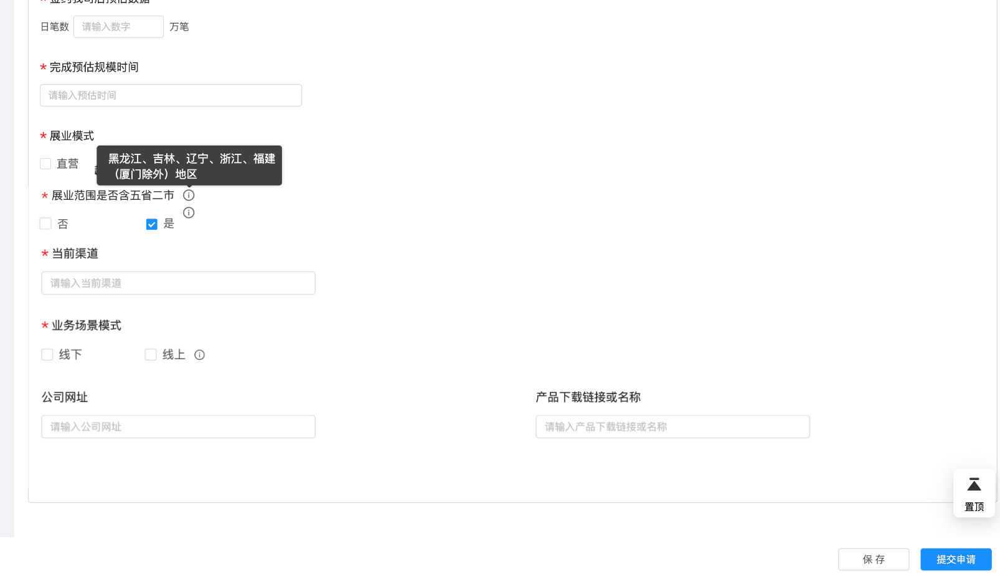
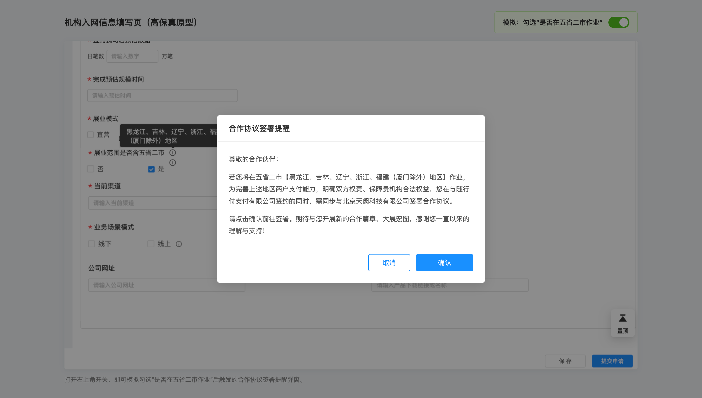
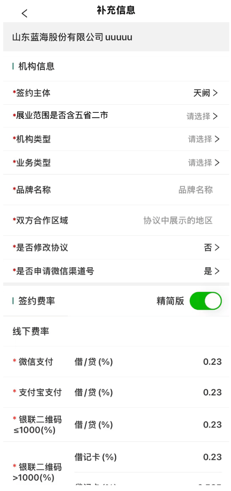
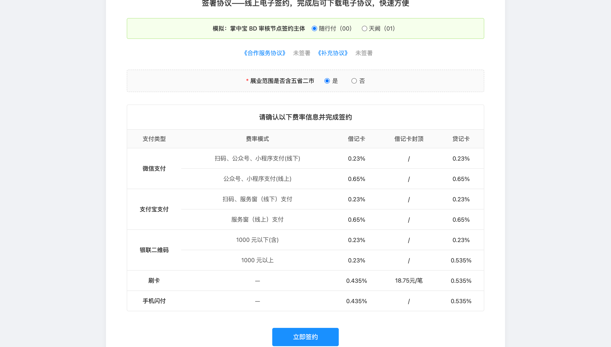
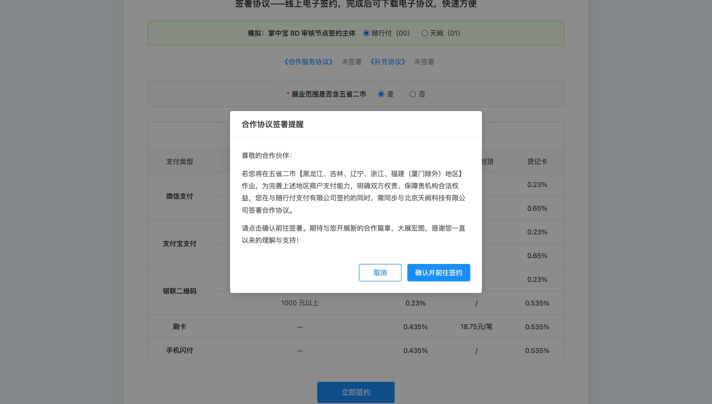
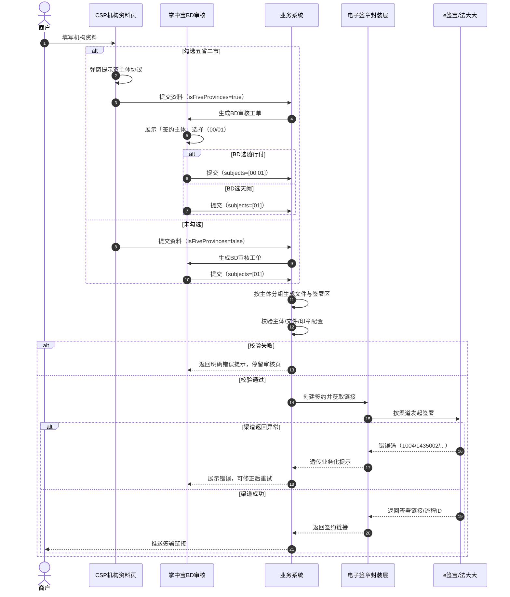

# 电子签章改造（e签宝 / 法大大）—— 多我司主体签署需求 PRD

## 0. 导读

| 项目 | 说明 |
|---|---|
| **需求目标** | 一次签署流程支持多个我司主体（甲方）共同签署 |
| **涉及渠道** | 多主体仅支持 e签宝；法大大保持单主体流程 |
| **业务场景** | 机构入网协议：五省二市作业需同时签署「随行付 + 天阙」双主体协议 |
| **核心改动** | 签约文件、签署方节点新增「我司主体」字段；业务层按主体分组连续传参 |
| **不变范围** | 坐标、回调、查询、下载、撤销、封装层映射、架构接口均沿用既有逻辑 |

**术语**

| 术语 | 含义 |
|---|---|
| 甲方 / 我司主体 | `00 随行付` / `01 天阙` / `02 重庆鑫联` |
| 乙方 | 签约商户及其经办人 |
| 封装层 | 内部电子签章封装服务，对接 e签宝/法大大 |

---

## 1. 背景与目标

### 1.1 背景

电子签章现状一次签署流程只能指定一个我司主体。机构入网场景中同一批协议的甲方主体可能不同（随行付、天阙），业务线只能拆成多个签约流程分别发起，签署体验割裂、状态对账成本高。

### 1.2 目标

1. **一次签署流程内支持多个我司主体签署**：单次调用可传入 2 个及以上甲方主体，生成一个签署流程。
2. **业务层改动最小化**：仅新增「我司主体编码」字段，其余字段复用既有结构。
3. **兼容存量单主体流程**：不传多主体时，原有单主体流程行为不变。

---

## 2. 推荐方案

### 2.1 方案核心

| 维度 | 规则 |
|---|---|
| 文件归属 | 每份签约文件必须携带「我司主体」，明确文件归属 |
| 签署方归属 | 每个甲方签署方节点携带「我司主体」，其签署区只绑定同主体文件 |
| 传参顺序 | 业务层按主体分组后顺序传入；同主体文件连续排列 |

### 2.2 方案对比

| 对比项 | 推荐方案：逐份标注 + 分节点传入 | 备选方案：全局指定主体 |
|---|---|---|
| 文件归属 | 每文件独立指定，清晰 | 按全局主体推断，易歧义 |
| 同协议多主体 | 支持未来扩展 | 不支持 |
| 与封装层契合度 | 高，与透传逻辑一致 | 低，需二次推断 |
| 校验复杂度 | 低，文件与签署方直接匹配 | 高，需维护映射关系 |

**推荐结论**：采用「逐份标注 + 分节点传入」方案，归属明确、校验简单、可扩展。

---

## 3. 业务触发场景：机构入网协议（CSP / 掌中宝）

### 3.1 方案总览

三个方案在「何时、在哪确认五省二市」上存在差异，推荐方案需业务侧结合掌中宝改造成本与用户体验最终确认。

| 方案 | 五省二市确认时机 | 确认页面 | 签约主体选择 | 电子签约页处理 | 适用倾向 |
|---|---|---|---|---|---|
| **方案一** | CSP 机构资料填写节点 | CSP 机构资料页 | BD 审核节点展示可选主体 | 按 BD 选择渲染；随行付时展示五省二市单选，天阙时不展示 | CSP 改造成本低 |
| **方案二** | 掌中宝 BD 审核节点 | 掌中宝 BD 审核页 | 与五省二市确认合并 | 按 BD 选择渲染；随行付时展示五省二市单选，天阙时不展示 | **推荐**：掌中宝改造可控，决策集中 |
| **方案三** | CSP 机构电子签约节点 | CSP 机构电子签约页 | BD 审核节点（或本页） | 在签约页首次必填五省二市；选「是」弹窗，选「否」直接跳转 | 掌中宝零改造，CSP 改动最大 |

### 3.2 方案一：CSP 机构资料填写节点

机构在 CSP 填写入网资料时即确认是否属于五省二市作业范围。

| 元素 | 说明 |
|---|---|
| 字段名称 | 是否在五省二市作业 |
| 控件类型 | 开关，默认「否」；勾选后可取消 |
| 提示说明 | 长按/点击小叹号，弹窗展示五省二市具体省市范围 |
| 勾选「是」后交互 | 弹窗「合作协议签署提醒」，点击「确认并前往签约」后进入后续流程 |
| 勾选「否」后交互 | 不弹窗，直接继续 |

弹窗文案：

> 尊敬的合作伙伴：若您将在五省二市【黑龙江、吉林、辽宁、浙江、福建（厦门除外）地区】作业，为完善上述地区商户支付能力，明确双方权责、保障贵机构合法权益，您在与随行付支付有限公司签约的同时，需同步与北京天阙科技有限公司签署合作协议。请点击签约链接完成协议签署。期待与您开展新的合作篇章，大展宏图，感谢您一直以来的理解与支持！

按钮：`取消` / `确认并前往签约`





### 3.3 方案二：掌中宝 BD 审核节点

BD 在掌中宝审核时确认五省二市，并同步完成「签约主体」选择。只有确认「是」后，才展示「随行付（00）」选项；确认「否」时仅展示「天阙（01）」。

| 五省二市 | BD 选择 | 生成协议 | 甲方主体 |
|---|---|---|---|
| 是 | 随行付（00） | 随行付协议 + 天阙协议 | 00、01 |
| 是 | 天阙（01） | 天阙协议 | 01 |
| 否 | 天阙（01）仅可选 | 天阙协议 | 01 |
| 否 | 随行付（00）不可选/选择不生效 | — | — |

> **兜底规则**：若 CSP 未勾选五省二市，BD 即使误选「随行付」，提交时按「天阙（01）」处理；掌中宝侧可前端置灰不可选，或后端强制覆盖为 01。



### 3.4 方案三：CSP 机构电子签约页确认

| 维度 | 说明 |
|---|---|
| 页面 | CSP 机构电子签约页 |
| 字段 | 新增「展业范围是否含五省二市」单选，默认未选中，必填 |
| 选择「是」 | 点击「立即签约」后弹出「合作协议签署提醒」弹窗，确认后跳转封装层 |
| 选择「否」 | 点击「立即签约」后直接跳转封装层，不弹窗 |
| 未选择时提交 | 提示「请先选择“展业范围是否含五省二市”后再进行签约」 |



### 3.5 电子签约页公共跳转规则

方案一、二中，CSP 机构电子签约页均根据掌中宝 BD 审核节点最终选择的「签约主体」渲染：

| BD 审核选择签约主体 | 电子签约页展示内容 | 点击「立即签约」行为 |
|---|---|---|
| 随行付（00） | 展示「展业范围是否含五省二市」单选（必填） | 选「是」→ 弹双主体确认窗 → 跳转封装层；选「否」→ 直接跳转封装层 |
| 天阙（01） | 不展示「五省二市」单选 | 直接跳转封装层 |

签约页字段规则：

| 元素 | 说明 |
|---|---|
| 字段名称 | 展业范围是否含五省二市 |
| 控件类型 | 单选（是 / 否），默认未选中 |
| 必填校验 | 未选择时点「立即签约」，提示「请先选择“展业范围是否含五省二市”后再进行签约」 |
| 选择「是」后交互 | 弹窗「合作协议签署提醒」，确认后跳转封装层 |
| 选择「否」后交互 | 不弹窗，直接跳转封装层 |




### 3.6 与签约接口的映射

| 前端决策结果 | 调用「创建签约并获取链接」时的主体配置 |
|---|---|
| 勾选五省二市 + BD 选随行付 | 一次签约流程含 2 个甲方主体（00、01） |
| 未勾选五省二市 或 BD 选天阙 | 单甲方流程（01） |

### 3.7 边界与配置说明

1. **文案配置**：五省二市范围文案、弹窗文案建议配置在运营后台，避免硬编码。
2. **前置条件校验**：掌中宝需在 BD 提交前校验：选择随行付时，机构必须同时满足两套协议的签署前置条件。
3. **修改与重审**：BD 提交前可修改签约主体；工单退回后重新进入审核节点可重新选择。
4. **未来扩展**：若新增第三个甲方主体（如 02 重庆鑫联），掌中宝选择逻辑与接口校验需同步扩展。

---

## 4. 主流程图



---

## 5. 对接封装层创建签约

CSP / 掌中宝不直接对接 e签宝/法大大，而是通过调用内部电子签章封装层的「创建签约并获取链接」接口完成签署。

### 5.1 接口说明

| 项 | 说明 |
|---|---|
| 接口路径 | `POST {封装层}/sign-flow/create`（路径沿用既有接口） |
| 调用方 | CSP / 掌中宝等业务系统 |
| 服务方 | 电子签章封装层 |
| 核心变化 | 多主体签署时，必须在「签约文件」和「签署方信息」中显式传入「我司主体」 |

### 5.2 新增/变更字段汇总

| 字段 | 位置 | 必填 | 类型 | 取值 | 变更 | 说明 |
|---|---|---|---|---|---|---|
| 我司主体 | 签约文件[].我司主体 | 是 | String | `00` / `01` / `02` | 新增 | 指定协议甲方归属；逐文件必传，无全局默认值 |
| 我司主体 | 签署方信息[].我司主体 | 是 | String | `00` / `01` / `02` | 新增 | 标识签署方代表的我司主体；甲方静默签、乙方手动签均需传入 |
| 我司主体 | 签署区信息[].我司主体 | 否 | String | `00` / `01` / `02` | 预留 | 当前阶段不实现；未来同协议多位置落章时使用 |
| 渠道类型 | 渠道类型 | 是 | String | `esign` / `fadada` | 限制 | 多主体场景当前仅支持 `esign`；fadada 一次流程仅支持单一甲方 |
| 文件顺序 | 签约文件数组顺序 | — | — | — | 约束 | 同主体文件必须连续排列，不同主体分组传入 |

> 应用标识、业务单号、签约文件内容/名称、签署区坐标、乙方企业/经办人信息、签约链接配置 等其他字段均沿用既有逻辑。

### 5.3 字段说明与传值规则

#### 5.3.1 我司主体编码

1. **传值规则**：业务系统根据最终确认的签约主体，将同主体文件与签署方标记为同一编码。
2. **取值范围**：`00` 随行付 / `01` 天阙 / `02` 重庆鑫联。
3. **校验规则**：必填，取值 ∈ `{00,01,02}`；一次流程去重后最多支持 8 个我司主体。

#### 5.3.2 签约文件

1. **主体标注**：每份协议必须携带「我司主体」，明确甲方归属。
2. **传参顺序**：按主体分组后顺序传入，同主体文件必须连续，示例：`[00文件1, 00文件2, 01文件1]`。
3. **业务单号**：多主体场景下，不同主体协议文件可共用同一个业务单号，一次调用生成完整签署流程。

#### 5.3.3 签署方信息

| 签署方类型 | 是否自动落章 | 需传字段 | 不传字段 |
|---|---|---|---|
| 甲方静默签 | true | 渠道企业账号ID（`customerId` / `orgId`）+ 我司主体 | 企业/经办人信息 |
| 乙方手动签 | false | 企业名称、统一社会信用代码、经办人姓名、经办人手机号 + 我司主体 | 渠道企业账号ID |

> **e签宝静默签特殊处理**：封装层会过滤掉企业/经办人信息，仅保留「渠道企业账号ID」，避免渠道返回 `1435002`。

#### 5.3.4 签署区信息

1. **关联文件**：「关联协议外部ID」必须指向同主体文件。
2. **签章坐标**：e签宝页码从 1 开始，法大大从 0 开始。
3. **印章指定**：e签宝指定印章传「印章ID」；法大大由封装层按「渠道企业账号ID」取默认章。

#### 5.3.5 渠道类型与处理规则

1. **多主体流程**：当前强制走 e签宝。
2. **法大大拦截**：若请求命中法大大且包含多个「我司主体」，封装层应拦截报错，或业务层前置校验。
3. **主体来源**：甲方主体一律由「签约文件[].我司主体」逐文件指定，无全局默认值。
4. **聚合规则**：同一主体的文件与签章区聚合为一个甲方签署方，`是否自动落章=true`，印章ID取该主体配置值。
5. **展示顺序**：业务层按固定主体顺序（先 `00`，再 `01`，最后 `02`）传入；封装层不做重排。
6. **乙方位置**：乙方签署方按存量逻辑生成，排在甲方签署方之后。

### 5.4 请求示例与映射结果

#### 5.4.1 业务层入参示例

一次批量签署 4 份协议、2 个甲方（随行付、天阙）、1 个乙方：

```json
{
  "应用标识": "tianque",
  "业务单号": "multi-partner-esign-003",
  "渠道类型": "esign",
  "签约文件": [
    { "协议外部ID": "A1001", "协议模板": "合作服务协议", "文件路径": "/files/A1001_sxf.pdf", "我司主体": "00" },
    { "协议外部ID": "A1002", "协议模板": "补充协议", "文件路径": "/files/A1002_sxf.pdf", "我司主体": "00" },
    { "协议外部ID": "B1001", "协议模板": "合作服务协议", "文件路径": "/files/B1001_tq.pdf", "我司主体": "01" },
    { "协议外部ID": "B1002", "协议模板": "补充协议", "文件路径": "/files/B1002_tq.pdf", "我司主体": "01" }
  ],
  "签署方信息": {
    "签署方类型": "01",
    "签约人类型": "01",
    "企业名称": "xxx商户",
    "统一社会信用代码": "9135xxxx",
    "经办人姓名": "张三",
    "经办人手机号": "13800138000"
  },
  "签署区信息": [
    { "协议外部ID": "A1001", "页码": "1", "坐标X": "300", "坐标Y": "200" },
    { "协议外部ID": "A1002", "页码": "1", "坐标X": "300", "坐标Y": "200" },
    { "协议外部ID": "B1001", "页码": "1", "坐标X": "300", "坐标Y": "200" },
    { "协议外部ID": "B1002", "页码": "1", "坐标X": "300", "坐标Y": "200" }
  ],
  "签约链接配置": {
    "是否需要登录": false,
    "经办人手机号": "17604861425"
  }
}
```

> **传参顺序即展示顺序**：业务层按随行付→天阙顺序传入，签署页按该顺序展示。封装层不做重排。

#### 5.4.2 常见错误传参

| 错误示例 | 问题 | 正确做法 |
|---|---|---|
| 漏传某份文件的「我司主体」 | 校验不通过，创建失败 | 每份文件都必须指定「我司主体」，无全局默认值 |
| 同一「协议外部ID」下，不同签章区传了不同「我司主体」 | 当前阶段会触发校验失败 | 如需同协议多甲方，走预留的「签署区维度我司主体」方案 |
| 把我司主体编码写成中文「随行付」 | 字段类型错误，校验不通过 | 使用编码 `00` / `01` / `02` |
| 多主体场景仍走法大大渠道 | 渠道不支持，创建失败 | 多主体仅支持 e签宝；法大大保持单主体调用 |

#### 5.4.3 封装层映射结果示例

```json
{
  "docs": [
    { "fileId": "F1", "fileName": "合作服务协议-随行付.pdf", "order": 1 },
    { "fileId": "F2", "fileName": "补充协议-随行付.pdf", "order": 2 },
    { "fileId": "F3", "fileName": "合作服务协议-天阙.pdf", "order": 3 },
    { "fileId": "F4", "fileName": "补充协议-天阙.pdf", "order": 4 }
  ],
  "signers": [
    {
      "signerType": 1,
      "signFields": [
        { "fileId": "F1", "normalSignFieldConfig": { "autoSign": true, "assignedSealId": "{随行付印章ID}", "signFieldPosition": { "positionPage": "1", "positionX": 300, "positionY": 200 } } },
        { "fileId": "F2", "normalSignFieldConfig": { "autoSign": true, "assignedSealId": "{随行付印章ID}", "signFieldPosition": { "positionPage": "1", "positionX": 300, "positionY": 200 } } }
      ]
    },
    {
      "signerType": 1,
      "signFields": [
        { "fileId": "F3", "normalSignFieldConfig": { "autoSign": true, "assignedSealId": "{天阙印章ID}", "signFieldPosition": { "positionPage": "1", "positionX": 300, "positionY": 200 } } },
        { "fileId": "F4", "normalSignFieldConfig": { "autoSign": true, "assignedSealId": "{天阙印章ID}", "signFieldPosition": { "positionPage": "1", "positionX": 300, "positionY": 200 } } }
      ]
    },
    {
      "signerType": 1,
      "orgSignerInfo": { "orgName": "xxx商户", "orgInfo": {}, "transactorInfo": {} },
      "signFields": [
        { "fileId": "F1", "normalSignFieldConfig": { "autoSign": false, "signFieldPosition": { "positionPage": "1", "positionX": 100, "positionY": 200 } } }
      ]
    }
  ]
}
```

### 5.5 校验规则

| 校验项 | 规则 | 拦截提示 |
|---|---|---|
| 我司主体必传且合法 | 逐文件、逐签署方校验已传且取值 ∈ {00,01,02} | 「签约文件[{序号}]未指定我司主体」 / 「我司主体取值不合法，仅支持00随行付/01天阙/02重庆鑫联」 |
| 甲方数量上限 | 去重后我司主体数 ≤ 8 | 「一次签约流程最多支持8个我司主体」 |
| 印章/账号配置 | 每个我司主体的印章ID、渠道企业账号ID 必须已配置 | 「主体[{主体名}]的电子印章/账号未配置，请联系运营」 |
| 签署方总数 | 甲方数 + 乙方数 ≤ 10（e签宝上限） | 「签署方数量超出上限」 |
| 签署区总数 | 全流程 ≤ 30 组（沿用） | 「最多传入30组签署区信息」 |
| 文件未按主体连续传入 | 同主体文件必须连续排列 | 「同一主体的文件需连续传入」 |
| 签署方主体与文件主体不匹配 | 签署区关联的文件主体须与签署方主体一致 | 「签署方主体与文件主体不一致」 |

### 5.6 返回与查询改造

#### 5.6.1 返回参数（不变）

| 参数名 | 类型 | 说明 |
|---|---|---|
| 签署流程ID | String | 封装层流程 ID |
| 签署链接 | String | 签署信息确认页 URL |

#### 5.6.2 查询与回调改造

| 参数名 | 类型 | 说明 |
|---|---|---|
| 签署方信息[].我司主体 | String | 签署方为我司时返回，多个甲方返回多组；取值 00/01/02 |

> 业务线可用于按主体归档、对账及追溯。

---

## 6. 异常处理

### 6.1 入参校验类（业务层拦截）

| 场景 | 提示 | 处理 |
|---|---|---|
| 主体未传 | 「签署方信息未指定我司主体」 | 拦截，返回创建失败 |
| 主体取值非法 | 「我司主体取值不合法，仅支持00随行付/01天阙/02重庆鑫联」 | 拦截 |
| 主体数超限 | 「一次签约流程最多支持8个我司主体」 | 拦截 |
| 文件未按主体连续传入 | 「同一主体的文件需连续传入」 | 拦截 |
| 签署方主体与文件主体不匹配 | 「签署方主体与文件主体不一致」 | 拦截 |
| 印章/账号未配置 | 「主体[XX]的电子印章/账号未配置，请联系运营」 | 拦截 |

### 6.2 运行时异常（渠道返回）

| 场景 | 渠道错误 | 业务层处理 |
|---|---|---|
| 同一 bizNo 重复发起 | 法大大/封装层 `Duplicate entry ... t_biz_no_app_un` | 幂等返回已创建流程的签署链接，不重复创建 |
| 法大大签章坐标为空 | `1004` | 透传「签章坐标不能为空，请检查坐标配置」 |
| e签宝盖章位置超出文件范围 | `1435002` | 透传「签章坐标超出文件范围，请检查页码/坐标」 |
| e签宝静默签传 orgSignerInfo | `1435002`（机构自动签署只允许传账号ID） | 封装层转换：静默签甲方只传 customerId/orgId，不透传 orgSignerInfo |
| 印章无跨企业授权 | — | 回退默认章；上线前需完成主体印章授权配置并纳入验收 |
| 渠道超时/服务异常 | — | 提示「签署服务暂不可用，请稍后重试」，bizNo 不变重试幂等 |
