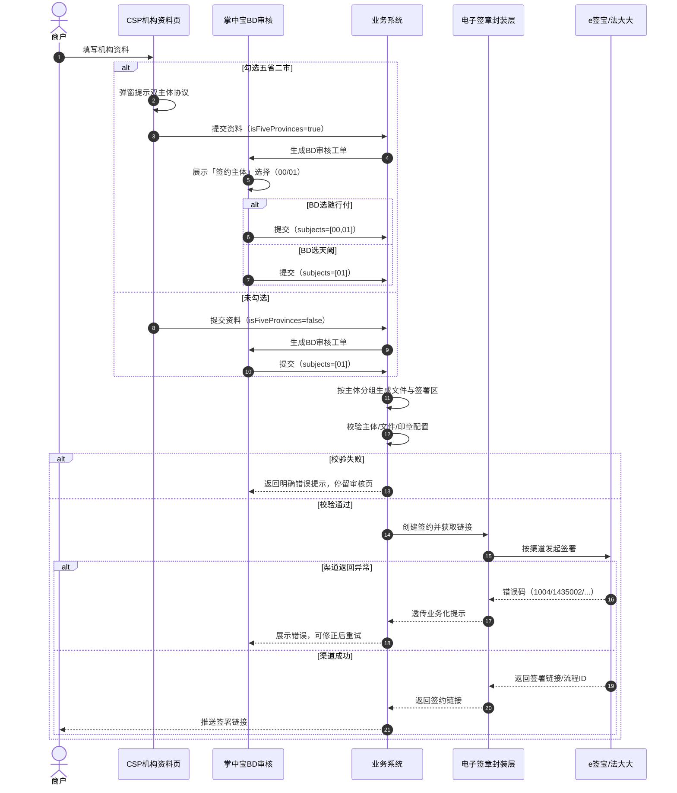

# 电子签章改造（e签宝 / 法大大）—— 多我司主体签署需求 PRD

| 版本 | 日期 | 作者 | 状态 | 变更说明 |
|---|---|---|---|---|
| V1.5 | 2026-11-10 | 产品 | 产品内审中 | 逐文件显式标注我司主体；补齐「未勾选+BD选随行付」组合场景；新增运行时异常与渠道错误码透传；细化字段规则；新增跨角色主流程图 |

**术语约定**：「甲方」即「我司主体」（`00 随行付` / `01 天阙` / `02 重庆鑫联`）。

**范围声明**：坐标、回调、查询、下载、撤销、封装层映射、架构接口均沿用既有逻辑，本文不展开。

---

## 1. 背景与目标

### 1.1 背景

电子签章现状一次签署流程只能指定一个我司主体。机构入网场景中同一批协议的甲方主体可能不同（随行付、天阙），业务线只能拆成多个签约流程分别发起，签署体验割裂、状态对账成本高。

### 1.2 目标

- 一次签署流程内支持多个我司主体（甲方）签署。
- 业务层以「我司主体编码」为最小改动点，其余字段尽量复用既有结构。
- 支持随行付/天阙双主体同时签署，也兼容单主体存量流程。

---

## 2. 推荐方案

**方案：签约文件逐份标注我司主体 + 签署方按主体分节点传入**

- 每份签约文件必须携带 `subjectCode`，明确文件归属。
- 每个甲方签署方节点同样携带 `subjectCode`，其 `signFields` 只绑定同主体文件。
- 业务层按主体分组后顺序传入文件；同主体文件连续排列。

**推荐理由**：与封装层透传逻辑一致（每个甲方 `signFields` 绑定自己的 `localDocumentKey`），归属明确、校验简单、可扩展。

---

## 3. 业务触发场景：机构入网协议（CSP / 掌中宝）

> 适用协议类型：机构入网协议。当机构属于「五省二市作业」范围时，需要同时签署随行付、天阙两份主体协议。

### 3.1 CSP 机构资料填写节点

| 元素 | 说明 |
|---|---|
| 字段名称 | 是否在五省二市作业 |
| 控件类型 | 开关，默认「否」；勾选后可取消 |
| 提示说明 | 长按/点击小叹号，弹窗展示五省二市具体省市范围（文案由产品/法务配置） |
| 勾选后交互 | 页面弹窗，标题「合作协议签署提醒」，正文：「尊敬的合作伙伴：若您将在五省二市【黑龙江、吉林、辽宁、浙江、福建（厦门除外）地区】作业，为完善上述地区商户支付能力，明确双方权责、保障贵机构合法权益，您在与随行付支付有限公司签约的同时，需同步与北京天阙科技有限公司签署合作协议。请点击签约链接完成协议签署。期待与您开展新的合作篇章，大展宏图，感谢您一直以来的理解与支持！」，按钮「取消 / 确认并前往签约」。 |

### 3.2 掌中宝 BD 审核节点

BD 在掌中宝审核时，新增「签约主体」选择。只有 CSP 勾选「五省二市」后，才展示「随行付（00）」选项；未勾选时仅展示「天阙（01）」。

| 五省二市 | BD 选择 | 生成协议 | 甲方主体 |
|---|---|---|---|
| 是 | 随行付（00） | 随行付协议 + 天阙协议 | 00、01 |
| 是 | 天阙（01） | 天阙协议 | 01 |
| 否 | 天阙（01）仅可选 | 天阙协议 | 01 |
| 否 | 随行付（00）不可选/选择不生效 | — | — |

> **组合场景说明**：若 CSP 未勾选五省二市，BD 即使误选「随行付」，提交时按「天阙（01）」处理；掌中宝侧可前端置灰不可选，或后端强制覆盖为 01。

### 3.3 CSP 机构电子签约页

电子签约页根据掌中宝 BD 审核节点最终选择的「签约主体」渲染：

| BD 审核选择签约主体 | 电子签约页展示内容 | 点击「立即签约」行为 |
|---|---|---|
| 随行付（00） | 展示「展业范围是否含五省二市」单选（必填） | 选「是」→ 弹双主体确认窗 → 点「确认并前往签约」跳转封装层；选「否」→ 不弹窗，直接跳转封装层 |
| 天阙（01） | 不展示「展业范围是否含五省二市」 | 直接跳转封装层 |

**说明**：
- 电子签约页以 BD 审核节点的最终选择为准。
- 仅当 BD 选择「随行付」时，才需要机构在签约页再次确认是否含五省二市；选择「天阙」时沿用单主体流程。
- 选择「是」后弹窗文案同 3.1 节。

| 元素 | 说明 |
|---|---|
| 字段名称 | 展业范围是否含五省二市 |
| 控件类型 | 单选（是 / 否），默认未选中 |
| 必填校验 | 未选择时点「立即签约」，提示「请先选择“展业范围是否含五省二市”后再进行签约」 |
| 选择「是」后交互 | 弹窗，标题「合作协议签署提醒」，按钮「取消 / 确认并前往签约」；点击确认后跳转封装层 |
| 选择「否」后交互 | 不弹窗，直接跳转封装层 |

### 3.4 与签约接口的映射

- CSP / 掌中宝最终调用「创建签约并获取链接」发起签署。
- 「勾选 + BD 选随行付」对应一次签约流程含 2 个甲方主体；「未勾选 或 BD 选天阙」对应单甲方流程。

### 3.5 边界与配置说明

- 五省二市范围文案、弹窗文案建议配置在运营后台，避免硬编码。
- 掌中宝需在 BD 提交前校验：选择随行付时，机构必须同时满足两套协议的签署前置条件。
- BD 提交前可修改签约主体；工单退回后重新进入审核节点可重新选择。
- 若后续新增第三个甲方主体（如 02 重庆鑫联），掌中宝选择逻辑与接口校验需同步扩展。

---

## 4. 主流程图



---

## 5. 接口定义

### 5.1 创建签约并获取链接

`POST /api/esign/create-sign-url`（业务层示例路径）

| 参数名 | 必填 | 类型 | 说明 |
|---|---|---|---|
| appId | 是 | string | 应用标识，如 `tianque` |
| bizNo | 是 | string | 业务单号，同一 appId 下全局唯一 |
| channelType | 是 | string | `esign` / `fadada` |
| localDocuments | 是 | array | 待签署文件列表，按主体分组连续传入 |
| localDocuments[].documentKey | 是 | string | 文件唯一标识 |
| localDocuments[].fileName | 是 | string | 文件名 |
| localDocuments[].fileBase64 | 是 | string | 文件内容 Base64 |
| localDocuments[].subjectCode | 是 | string | 我司主体编码：`00`/`01`/`02` |
| signature.signers | 是 | array | 签署方列表，按签署顺序排列 |
| signature.signers[].signerType | 是 | int | `0` 个人 / `1` 企业 |
| signature.signers[].customerId | 条件 | string | 甲方静默签时传，渠道企业账号ID |
| signature.signers[].orgSignerInfo | 条件 | object | 乙方/手动签企业信息，静默签时不传 |
| signature.signers[].subjectCode | 是 | string | 该签署方代表的我司主体编码 |
| signature.signers[].signFields | 是 | array | 签署区，绑定同主体文件 |
| signFields[].localDocumentKey | 是 | string | 关联文件，必须属于同主体 |
| signFields[].normalSignFieldConfig.autoSign | 是 | boolean | `true` 静默签 / `false` 手动签 |
| signFields[].normalSignFieldConfig.assignedSealId | 条件 | string | e签宝指定印章ID；法大大通道由封装层按 customerId 取默认章 |
| signFields[].normalSignFieldConfig.signFieldPosition | 是 | object | 签章位置（e签宝页码从1开始，法大大从0开始） |

> **说明**：业务层不直接对接 e签宝/法大大，而是调用内部封装层。「我司主体」由封装层映射为对应渠道的账号/印章。

### 5.2 请求示例（2 甲方 + 1 乙方，双文件）

```json
{
  "appId": "tianque",
  "bizNo": "multi-partner-esign-003",
  "channelType": "esign",
  "localDocuments": [
    {
      "documentKey": "contract1234561233",
      "fileName": "随行付协议.pdf",
      "fileBase64": "1",
      "subjectCode": "00"
    },
    {
      "documentKey": "contract1234561234",
      "fileName": "天阙协议.pdf",
      "fileBase64": "1",
      "subjectCode": "01"
    }
  ],
  "signature": {
    "signFlowConfig": { "signFlowTitle": "多主体签署" },
    "signers": [
      {
        "signerType": 1,
        "subjectCode": "00",
        "orgSignerInfo": {
          "orgName": "测试企业有限公司1",
          "orgInfo": {},
          "transactorInfo": {}
        },
        "signFields": [
          {
            "localDocumentKey": "contract1234561233",
            "normalSignFieldConfig": {
              "autoSign": false,
              "signFieldPosition": { "positionPage": "1", "positionX": 40, "positionY": 40 }
            }
          }
        ]
      },
      {
        "signerType": 1,
        "subjectCode": "00",
        "customerId": "F00AB31B9FD8508061B172D777245677",
        "signFields": [
          {
            "localDocumentKey": "contract1234561233",
            "normalSignFieldConfig": {
              "autoSign": true,
              "assignedSealId": "91158",
              "signFieldPosition": { "positionPage": "1", "positionX": 20, "positionY": 20 }
            }
          }
        ]
      },
      {
        "signerType": 1,
        "subjectCode": "01",
        "customerId": "949306808EEB2B0B854FB5EC847B8EFB",
        "signFields": [
          {
            "localDocumentKey": "contract1234561234",
            "normalSignFieldConfig": {
              "autoSign": true,
              "assignedSealId": "IDc2873a51-bdfb-4898-a5b3-eb6adef96299",
              "signFieldPosition": { "positionPage": "1", "positionX": 20, "positionY": 20 }
            }
          }
        ]
      }
    ]
  },
  "signUrl": {
    "needLogin": false,
    "operator": { "psnAccount": "17604861425" }
  }
}
```

---

## 6. 字段规则

| 字段 | 输入方式 | 字符限制 | 校验规则 |
|---|---|---|---|
| 我司主体 subjectCode | 系统枚举（2位编码） | 固定 2 位 | 必填，取值 ∈ {00,01,02} |
| 是否五省二市 | CSP 开关 | — | 默认「否」，勾选后可取消 |
| BD 签约主体 | 掌中宝选择 | — | 未勾选仅显示 01；勾选显示 00/01；提交前可修改 |
| 文件顺序 | 业务系统传入 | — | 同主体文件连续，不同主体分组排列 |
| 签署方顺序 | signers 数组顺序 | — | 不传 signOrder 默认按数组顺序；文件展示同数组顺序 |
| bizNo | 业务系统生成 | ≤64 字符 | 必填，同一 appId 下全局唯一，重复时幂等返回 |

---

## 7. 异常处理

### 7.1 入参校验类（业务层拦截）

| 场景 | 提示 | 处理 |
|---|---|---|
| 主体未传 | 「签署方信息未指定我司主体」 | 拦截，返回创建失败 |
| 主体取值非法 | 「我司主体取值不合法，仅支持00随行付/01天阙/02重庆鑫联」 | 拦截 |
| 主体数超限 | 「一次签约流程最多支持8个我司主体」 | 拦截 |
| 文件未按主体连续传入 | 「同一主体的文件需连续传入」 | 拦截 |
| 签署方主体与文件主体不匹配 | 「签署方主体与文件主体不一致」 | 拦截 |
| 印章/账号未配置 | 「主体[XX]的电子印章/账号未配置，请联系运营」 | 拦截 |

### 7.2 运行时异常（渠道返回）

| 场景 | 渠道错误 | 业务层处理 |
|---|---|---|
| 同一 bizNo 重复发起 | 法大大/封装层 `Duplicate entry ... t_biz_no_app_un` | 幂等返回已创建流程的签署链接，不重复创建 |
| 法大大签章坐标为空 | `1004` | 透传「签章坐标不能为空，请检查坐标配置」 |
| e签宝盖章位置超出文件范围 | `1435002` | 透传「签章坐标超出文件范围，请检查页码/坐标」 |
| e签宝静默签传 orgSignerInfo | `1435002`（机构自动签署只允许传账号ID） | 封装层转换：静默签甲方只传 customerId/orgId，不透传 orgSignerInfo |
| 印章无跨企业授权 | — | 回退默认章；上线前需完成主体印章授权配置并纳入验收 |
| 渠道超时/服务异常 | — | 提示「签署服务暂不可用，请稍后重试」，bizNo 不变重试幂等 |

---

## 8. 安全策略

- 全链路 HTTPS 传输；身份证、银行卡、手机号等敏感字段加密存储与传输。
- bizNo 幂等控制，防止重复创建签约流程。
- 接口调用日志审计，保留渠道原始报文便于排查。
- 印章 ID、渠道账号 ID 等凭据仅在后端配置，不下发前端。

---

## 9. 验收标准

| # | 场景 | 预期 |
|---|---|---|
| 1 | 2 甲方 + 1 乙方批量签署（双文件，00→01） | 创建成功；签署页按传入顺序展示；各主体落各自印章 |
| 2 | 存量单甲方调用 | 行为与改造前一致 |
| 3 | 主体漏传 / 非法值 / 数量&gt;8 / 印章账号未配置 / 文件未连续传入 / 签署方与文件主体不一致 | 分别拦截并返回对应提示 |
| 4 | CSP 勾选五省二市 + BD 选随行付 | 一次流程创建成功，含 00、01 两主体 |
| 5 | CSP 未勾选 + BD 误选随行付 | 强制按 01 单主体创建，不生成 00 协议 |
| 6 | 同一 bizNo 重复发起 | 幂等返回已创建签署链接，不报错、不重复创建 |
| 7 | 渠道坐标类错误（1004 / 1435002） | 透传业务化提示，前端可读 |
| 8 | 签约完成后下载 | 文件含各主体印章与乙方签名，下载地址可访问 |

---

## 10. 版本记录

| 版本 | 日期 | 变更 |
|---|---|---|
| V1.5 | 2026-11-10 | 签约文件逐份标注 subjectCode；补齐「未勾选+BD选随行付」组合场景；新增运行时异常与渠道错误码透传；细化字段规则；新增跨角色主流程图 |
| V1.4 | 2026-11-09 | 新增签署方信息[].我司主体按主体传参；补充 CSP / 掌中宝 机构入网协议业务触发场景 |
